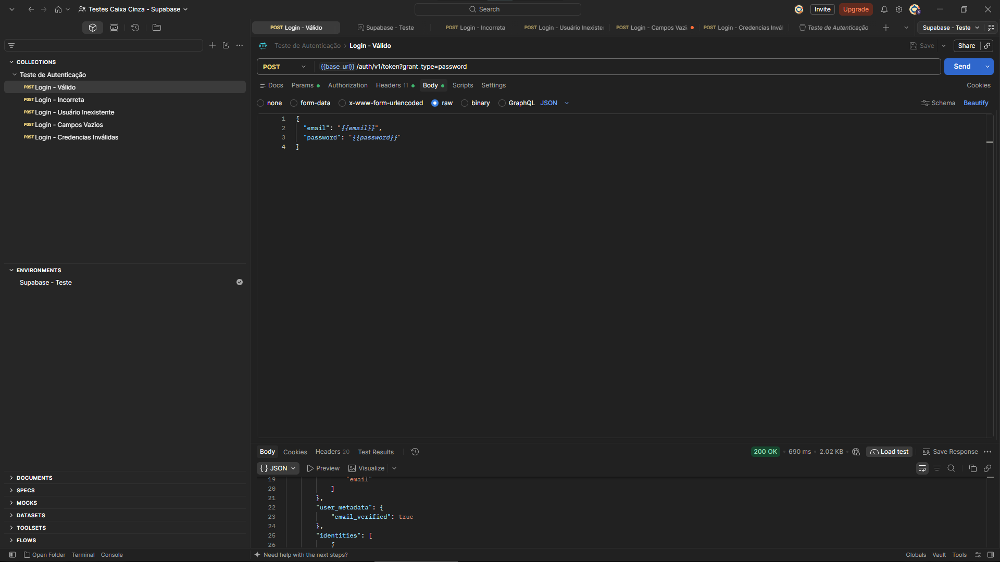
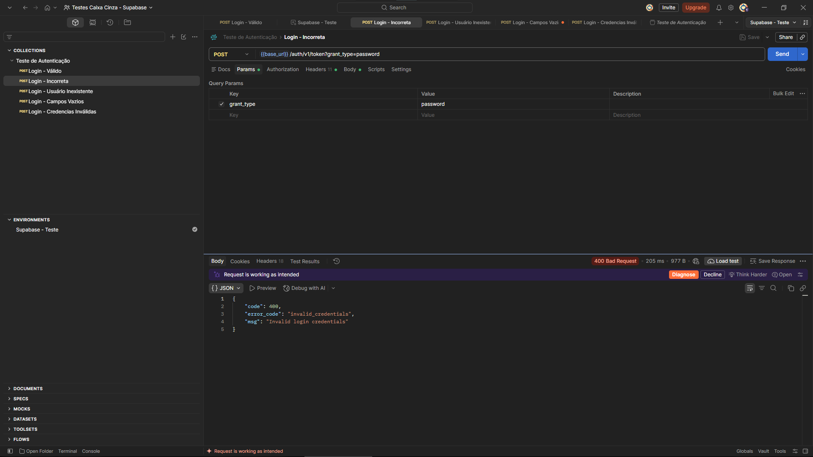
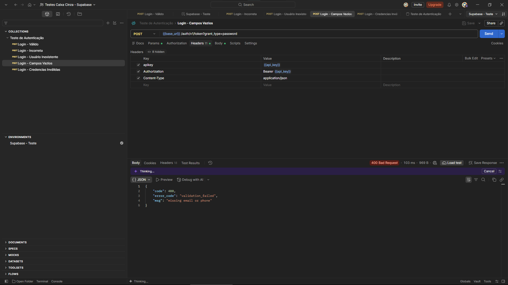
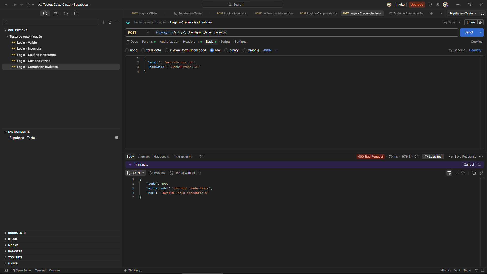

# Projeto de Testes Caixa Cinza — Supabase

> Projeto acadêmico desenvolvido com foco em Qualidade de Software, testes de autenticação de API, documentação e análise de resultados.

---

## 1. Identificação do Projeto

**Projeto:** Testes Caixa Cinza — Autenticação Supabase  
**Contexto:** Validação de autenticação por e-mail e senha via API REST  
**Aluno:** Kauê David Simões De Oliveira
**RA:** 251270
**Curso:** Análise e Desenvolvimento de Sistemas  
**Disciplina:** UX/UI e Testes de Software 
**Professor:** DANIEL DOMINGOS AKIRA DE SA PIMENTEL OHATA  
**Semestre:** 2026.2

---

## 2. Visão Geral

O projeto realiza testes de autenticação em uma API do Supabase usando o Postman. A abordagem de **caixa cinza** combina conhecimento parcial da estrutura interna do sistema — endpoint, parâmetros, cabeçalhos e funcionamento esperado da autenticação — com a avaliação das respostas observadas externamente.

Foram executados cinco cenários para verificar o comportamento do login com entradas válidas e inválidas, analisando os códigos HTTP e as mensagens retornadas.

---

## 3. Problema

Uma API de autenticação precisa aceitar credenciais válidas e rejeitar tentativas incorretas de maneira previsível. Falhas nesse fluxo podem comprometer o acesso à aplicação ou dificultar o diagnóstico de erros.

O desafio foi preparar requisições reproduzíveis, configurar corretamente o ambiente e comparar o resultado obtido com o comportamento esperado em diferentes cenários.

---

## 4. Objetivo

### 4.1 Objetivo Geral

Validar o comportamento do endpoint de login do Supabase por meio de testes de caixa cinza realizados no Postman.

### 4.2 Objetivos Técnicos

- Configurar um projeto de teste no Supabase.
- Criar um usuário de teste para autenticação por e-mail e senha.
- Configurar variáveis de ambiente no Postman sem expor credenciais.
- Enviar requisições HTTP `POST` com corpo JSON.
- Verificar os códigos HTTP e as mensagens de erro.
- Documentar os cenários, evidências e resultados.

---

## 5. Escopo Funcional

| ID | Funcionalidade testada | Descrição | Resultado observado |
|---|---|---|---|
| RF01 | Login válido | Autenticação com usuário e senha corretos | `200 OK` |
| RF02 | Senha incorreta | Login com senha diferente da cadastrada | `400 Bad Request` |
| RF03 | Usuário inexistente | Login com e-mail não cadastrado | `400 Bad Request` |
| RF04 | Campos vazios | Requisição sem e-mail e senha | `400 Bad Request` |
| RF05 | Credenciais inválidas | Login com e-mail malformado e senha incorreta | `400 Bad Request` |

**Observação:** o status `400` é um resultado esperado nos cenários negativos apresentados, e não significa necessariamente que o teste falhou.

---

## 6. Requisitos Não Funcionais

| ID | Categoria | Requisito |
|---|---|---|
| RNF01 | Segurança | Não divulgar senhas, tokens de sessão ou chaves secretas nas evidências |
| RNF02 | Confiabilidade | Rejeitar credenciais inválidas com respostas previsíveis |
| RNF03 | Testabilidade | Permitir repetição dos cenários por meio de uma Collection |
| RNF04 | Documentação | Registrar configurações, resultados e evidências |
| RNF05 | Organização | Separar cenários positivos e negativos e usar nomes descritivos |
| RNF06 | Rastreabilidade | Relacionar cada teste a um resultado HTTP e a uma captura de tela |

---

## 7. Tecnologias Utilizadas

| Tecnologia | Versão | Utilização |
|---|---|---|
| Supabase | Serviço online | Plataforma de autenticação e API |
| Supabase Auth | Serviço gerenciado | Autenticação por e-mail e senha |
| Postman | [Informar versão] | Envio e inspeção de requisições HTTP |
| HTTP / REST | — | Comunicação com o endpoint de autenticação |
| JSON | — | Formato dos dados enviados e recebidos |
| Git / GitHub | [Se utilizado] | Armazenamento e versionamento dos arquivos |
| Markdown | — | Documentação no README |

---

## 8. Estrutura do Projeto

Estrutura sugerida para a entrega (ajustar aos nomes reais dos arquivos):

```text
projeto_testes_caixa_cinza/
│
├── postman/
│   ├── Teste_de_Autenticacao.postman_collection.json
│   └── Supabase_Teste.exemplo.postman_environment.json
│
├── prints/
│   ├── 01_login_valido.png
│   ├── 02_senha_incorreta.png
│   ├── 03_usuario_inexistente.png
│   ├── 04_campos_vazios.png
│   └── 05_credenciais_invalidas.png
│
├── planilha/
│   └── casos_de_teste.xlsx
│
├── README.md
└── .gitignore
```

**Importante:** exporte apenas um ambiente de exemplo com valores fictícios ou vazios. Não publique o ambiente real com senha, tokens ou chaves secretas.

---

## 9. Configuração e Execução dos Testes

### 9.1 Preparação

1. Criar um projeto no Supabase e habilitar a autenticação por e-mail.
2. Criar um usuário de teste e garantir que esteja apto a efetuar login.
3. No Postman, criar um ambiente com as variáveis `base_url`, `api_key`, `email` e `password`.
4. Usar uma **publishable key** em `api_key`; não usar `secret key` no Postman para esses testes.
5. Configurar a requisição abaixo:

**Método:** `POST`  
**URL:** `{{base_url}}/auth/v1/token?grant_type=password`

**Cabeçalhos:**

```http
apikey: {{api_key}}
Content-Type: application/json
```

**Corpo do login válido:**

```json
{
  "email": "{{email}}",
  "password": "{{password}}"
}
```

O campo `Authorization` pode ser omitido nesse teste de login. Se a Collection o utilizar, confira se não está enviando uma credencial secreta ou um token de usuário indevido.

### 9.2 Casos de Teste e Resultados

| Caso | Entrada | HTTP esperado | HTTP obtido | Mensagem / evidência | Situação |
|---|---|---|---|---|---|
| CT01 — Login válido | E-mail e senha corretos | 200 | 200 | Retorno de sessão e usuário | Conforme |
| CT02 — Senha incorreta | E-mail válido e senha errada | 400 | 400 | `invalid_credentials` | Conforme |
| CT03 — Usuário inexistente | E-mail não cadastrado | 400 | 400 | `invalid_credentials` | Conforme |
| CT04 — Campos vazios | E-mail e senha vazios | 400 | 400 | `validation_failed`: `missing email or phone` | Conforme |
| CT05 — Credenciais inválidas | Identificador inválido e senha errada | 400 | 400 | `invalid_credentials` | Conforme |

Os resultados acima foram observados nas capturas apresentadas durante a execução. A situação “Conforme” se refere à comparação com o comportamento esperado para cada cenário, não a uma auditoria completa de segurança.

### 9.3 Evidências

Inclua as imagens nos caminhos abaixo, **ocultando tokens de acesso, tokens de atualização, senhas e dados pessoais** antes de publicá-las.

**CT01 — Login válido**



**CT02 — Senha incorreta**



**CT03 — Usuário inexistente**


**CT04 — Campos vazios**



**CT05 — Credenciais inválidas**



### 9.4 Dificuldades e Soluções

Durante a preparação, uma tentativa inicial apresentou `getaddrinfo ENOTFOUND`, relacionada à resolução do endereço configurado em `base_url`. Após revisar a URL do projeto e a configuração do ambiente, o login válido retornou `200 OK`.

Em outro momento, a API respondeu `401 Unauthorized` com a mensagem `No API key found in request`. A correção foi conferir a presença do cabeçalho `apikey` e o uso da variável de ambiente apropriada.

Esses erros de configuração foram diferenciados dos resultados esperados nos cenários negativos de autenticação.

### 9.5 Conclusão

Os cinco cenários executados apresentaram os códigos HTTP e as mensagens esperadas para as entradas utilizadas. O teste positivo confirmou a autenticação com credenciais válidas; os testes negativos demonstraram a rejeição de credenciais incorretas ou ausentes.

A atividade permitiu aplicar testes de caixa cinza, interpretar respostas de API, organizar evidências e compreender a importância de configurações seguras e documentação reproduzível. Os resultados são limitados aos cenários executados e não representam uma avaliação integral da segurança do Supabase.

---

## 10. Cuidados de Segurança

- Nunca incluir `sb_secret_...`, senhas reais ou tokens `access_token` e `refresh_token` no repositório.
- Preferir variáveis locais e valores fictícios em arquivos compartilhados.
- Revisar capturas de tela e arquivos exportados antes de enviá-los ao GitHub.
- Se uma credencial real tiver sido exposta, alterá-la ou revogá-la conforme o tipo de credencial.
